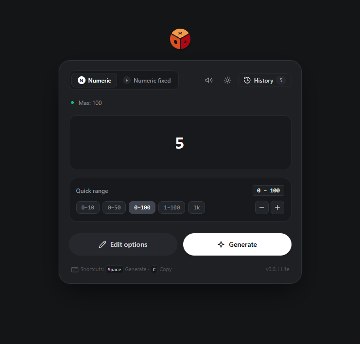
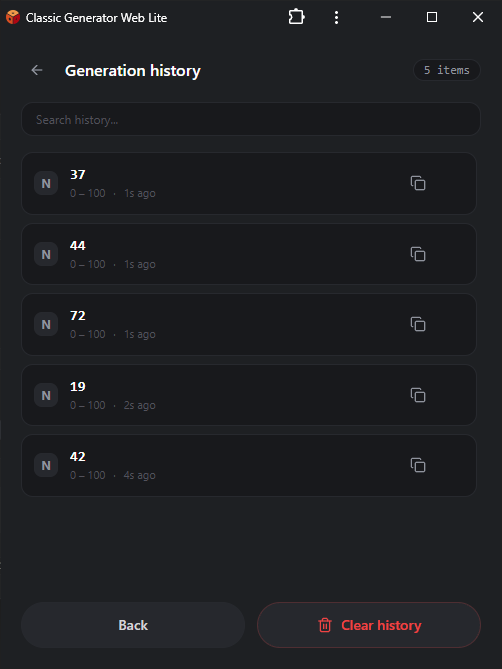

# Classic Generator Web Lite

<p align="center">
  
</p>

A desktop-first, lightweight, 100% client-side web version of Classic Generator. Inspired by the sleek dark card design of modern desktop utilities, it delivers instant, offline-capable random generation with browser `localStorage` persistence, Web Audio API sound feedback, and comprehensive keyboard shortcuts.

<p align="center">
  
</p>

---

## Features

- **Installable Desktop App (PWA)**: Installable directly as a standalone desktop app via modern browsers, featuring custom window geometry, service worker offline caching, and responsive fluid layout.

  <p align="center">
    
  </p>
- **Client-Side Only**: Runs entirely in the browser with zero external server dependencies. Works offline.
- **Local Storage Persistence**: Generation history, options, active generator selection, sound state, and theme preferences persist automatically in browser `localStorage`.
- **Two Generators (Android ClassicGenerator Parity)**:
  - **Numeric (`NUM`)**: Generates random numbers within a configurable range (default: 0 up to 100), with upper bound or min/max options.
  - **Numeric fixed (`NUM_FIXED`)**: Generates exact fixed-length numbers (preserving leading zeroes, e.g., `048192`), formatted into readable grouped digit chunks.
- **Inspiration Card UI**:
  - Centered floating card with subtle border, shadow, and rounded corners.
  - High-contrast, large-format monospace display with alternating chunk contrast.
  - Sub-card displaying the immediately preceding generated value with one-click reuse or copy.
  - Smooth in-card view transitions between **Generator** and **History**.
- **Desktop Keyboard Navigation**:
  - Full keyboard accessibility with <kbd>Space</kbd> / <kbd>Enter</kbd> to generate, <kbd>C</kbd> to copy, <kbd>1</kbd>/<kbd>2</kbd> for generator selection, <kbd>O</kbd> to focus options input, <kbd>H</kbd> for history, and <kbd>Esc</kbd> to return.
- **Web Audio Feedback**:
  - Lightweight synthesized mechanical click/pop sounds generated directly through the Web Audio API without audio file assets.
  - Header audio toggle with persistent state.
- **Theme Support**:
  - Sleek dark theme by default matching the design inspiration, with a light mode toggle.

---

## Keyboard Shortcuts

| Shortcut | Action |
| :--- | :--- |
| <kbd>Space</kbd> or <kbd>Enter</kbd> | Generate a new random value |
| <kbd>C</kbd> | Copy currently displayed value to clipboard |
| <kbd>1</kbd> | Switch to **Numeric** generator |
| <kbd>2</kbd> | Switch to **Numeric fixed** generator |
| <kbd>O</kbd> | Focus **Options** input |
| <kbd>H</kbd> | Toggle **History** log |
| <kbd>Esc</kbd> | Return to main generator view / dismiss overlays |
| <kbd>?</kbd> | Show keyboard shortcuts guide |

---

## Tech Stack

- **Bundler & Dev Server**: [Vite](https://vite.dev/)
- **Language**: [TypeScript](https://www.typescriptlang.org/)
- **Styling**: [Tailwind CSS](https://tailwindcss.com/)
- **Testing**: [Vitest](https://vitest.dev/)
- **Runtime Framework Overhead**: None (Vanilla DOM + TypeScript)

---

## Getting Started

### Prerequisites

- Node.js (v18+)
- `pnpm` (or `npm`)

### Installation

```bash
pnpm install
```

### Development Server

Start Vite local development server:

```bash
pnpm dev
```

### Production Build

Compile TypeScript and build static assets:

```bash
pnpm build
```

The compiled output will be placed in the `dist/` directory.

### Running Tests

Execute unit tests with Vitest:

```bash
pnpm test
```

---

## Cloudflare Pages Deployment

This project deploys to Cloudflare Pages out of the box with zero custom server logic or edge functions required.

### Option 1: Git Integration (Recommended)

1. In the Cloudflare dashboard, navigate to **Workers & Pages** > **Create application** > **Pages** > **Connect to Git**.
2. Select your repository and configure the build settings:
   - **Framework preset**: `Vite` (or `None`)
   - **Build command**: `pnpm build` (or `npm run build`)
   - **Build output directory**: `dist`
3. Click **Save and Deploy**.

### Option 2: Direct Upload via Wrangler CLI

You can also deploy directly from your local terminal using Wrangler:

```bash
pnpm build
npx wrangler pages deploy dist --project-name classic-generator-web-lite
```
